# Digital Wallet Risk Intelligence — SQL Exploratory Analysis

**Dataset:** Onyx DataDNA African Gig-Economy & Digital Wallet Risk  
**Tools:** XAMPP / MariaDB / phpMyAdmin  
**Data version:** Raw staging tables, before Python data cleaning  
**Purpose:** Document the business/data questions, SQL queries, original results and short findings in one place.

> **Evidence note:** Screenshots were supplied in `transimg.docx`. The SQL below is based on the previously prepared general-EDA queries and designed to reproduce the displayed results; because the screenshots show outputs rather than SQL statements, confirm the queries match your own executed code before presenting them as exact originals. These are exploratory findings, not validated fraud conclusions.

## At a glance

| Measure | Result |
|---|---:|
| Transaction records | 50,000 |
| Worker profiles | 5,000 |
| Unique transacting workers | 4,999 |
| Date coverage | 1 Jan 2023 – 31 Dec 2024 |
| Fraud-flagged transactions | 25,145 (50.29%) |
| Missing values | 731, all in the date dimension |

---

## 01 — Dataset overview

### Q1. What is the shape of each dataset?

**SQL query**

```sql
SELECT 'raw_fact_transactions' AS table_name,
       COUNT(*) AS total_rows,
       (SELECT COUNT(*) FROM INFORMATION_SCHEMA.COLUMNS
        WHERE TABLE_SCHEMA = 'digital_wallet_risk'
          AND TABLE_NAME = 'raw_fact_transactions') AS total_columns
FROM raw_fact_transactions
UNION ALL
SELECT 'raw_dim_worker', COUNT(*),
       (SELECT COUNT(*) FROM INFORMATION_SCHEMA.COLUMNS
        WHERE TABLE_SCHEMA = 'digital_wallet_risk'
          AND TABLE_NAME = 'raw_dim_worker')
FROM raw_dim_worker
UNION ALL
SELECT 'raw_dim_channel', COUNT(*),
       (SELECT COUNT(*) FROM INFORMATION_SCHEMA.COLUMNS
        WHERE TABLE_SCHEMA = 'digital_wallet_risk'
          AND TABLE_NAME = 'raw_dim_channel')
FROM raw_dim_channel
UNION ALL
SELECT 'raw_dim_market', COUNT(*),
       (SELECT COUNT(*) FROM INFORMATION_SCHEMA.COLUMNS
        WHERE TABLE_SCHEMA = 'digital_wallet_risk'
          AND TABLE_NAME = 'raw_dim_market')
FROM raw_dim_market
UNION ALL
SELECT 'raw_dim_date', COUNT(*),
       (SELECT COUNT(*) FROM INFORMATION_SCHEMA.COLUMNS
        WHERE TABLE_SCHEMA = 'digital_wallet_risk'
          AND TABLE_NAME = 'raw_dim_date')
FROM raw_dim_date;
```

**Result screenshot**

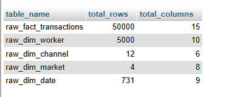

**Commentary**

The five raw tables contain **50,000 transactions, 5,000 worker profiles, 12 channels, 4 markets and 731 dates**, with **48 columns** in total. These counts establish the original-data baseline for later validation.

---

### Q2. How many transactions, unique workers and transaction dates are recorded?

**SQL query**

```sql
SELECT
    COUNT(*) AS total_transactions,
    COUNT(DISTINCT worker_id) AS unique_transacting_workers,
    COUNT(DISTINCT date_id) AS days_with_transactions
FROM raw_fact_transactions;
```

**Result screenshot**

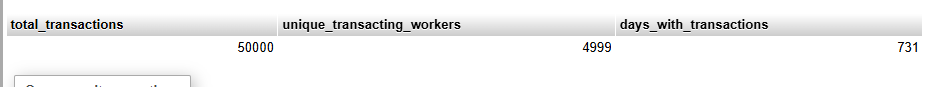

**Commentary**

**50,000 transactions** involve **4,999 distinct transacting workers** across **731 dates**. Distinct workers who transacted are not the same metric as total registered worker profiles (5,000).

---

### Q3. What is the transaction date range?

**SQL query**

```sql
SELECT
    MIN(STR_TO_DATE(date_id, '%Y%m%d')) AS first_transaction_date,
    MAX(STR_TO_DATE(date_id, '%Y%m%d')) AS last_transaction_date
FROM raw_fact_transactions;
```

**Result screenshot**

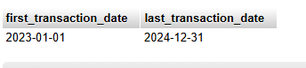

**Commentary**

Transactions span **1 January 2023 to 31 December 2024**, providing a two-year observation window that includes the 2024 leap day.

---

### Q4. How many transactions occurred in each month?

**SQL query**

```sql
SELECT
    DATE_FORMAT(STR_TO_DATE(date_id, '%Y%m%d'), '%Y-%m') AS transaction_month,
    COUNT(*) AS transaction_count
FROM raw_fact_transactions
GROUP BY DATE_FORMAT(STR_TO_DATE(date_id, '%Y%m%d'), '%Y-%m')
ORDER BY transaction_count DESC;
```

**Result screenshot**

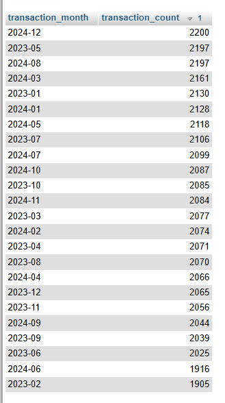

**Commentary**

The screenshot ranks months by number of transactions. **December 2024 had the highest count, 2,200**, while **February 2023 had 1,905**. For a time-series chart, sort by month instead of transaction count.

---

## 02 — Transaction composition

### Q5. How are transactions distributed across countries?

**SQL query**

```sql
SELECT
    m.country,
    COUNT(*) AS transaction_count,
    ROUND(100.0 * COUNT(*) / (SELECT COUNT(*) FROM raw_fact_transactions), 2)
        AS share_of_all_transactions_pct
FROM raw_fact_transactions f
JOIN raw_dim_market m ON f.market_id = m.market_id
GROUP BY m.country
ORDER BY transaction_count DESC;
```

**Result screenshot**

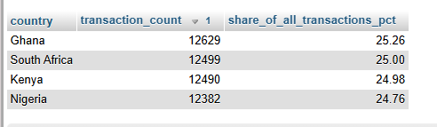

**Commentary**

Transaction shares are close across **Ghana (25.26%)**, **South Africa (25.00%)**, **Kenya (24.98%)** and **Nigeria (24.76%)**. These shares describe activity, **not fraud risk**.

---

### Q6. Which payment channels process the most transactions?

**SQL query**

```sql
SELECT
    c.channel_type,
    COUNT(*) AS transaction_count,
    ROUND(100.0 * COUNT(*) / (SELECT COUNT(*) FROM raw_fact_transactions), 2)
        AS share_of_all_transactions_pct
FROM raw_fact_transactions f
JOIN raw_dim_channel c ON f.channel_id = c.channel_id
GROUP BY c.channel_type
ORDER BY transaction_count DESC;
```

**Result screenshot**

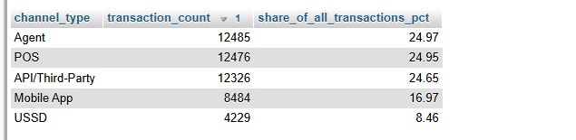

**Commentary**

**Agent (24.97%)**, **POS (24.95%)** and **API/Third-Party (24.65%)** lead in activity; **USSD (8.46%)** is least used in the recorded data. Volume alone does not establish performance or risk.

---

### Q7. Which transaction types occur most often?

**SQL query**

```sql
SELECT
    transaction_type,
    COUNT(*) AS transaction_count
FROM raw_fact_transactions
GROUP BY transaction_type
ORDER BY transaction_count DESC;
```

**Result screenshot**

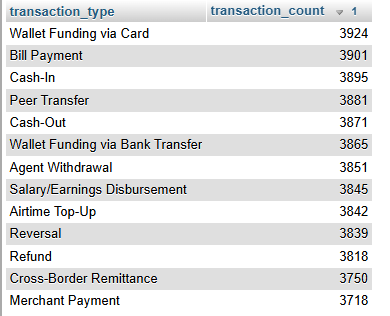

**Commentary**

The dataset contains **13 transaction types**. **Wallet Funding via Card (3,924)** has the most recorded transactions; **Merchant Payment (3,718)** has the fewest. Differences in counts should not be interpreted as failures.

---

### Q8. Which gig-worker segments account for the most transactions?

**SQL query**

```sql
SELECT
    w.gig_segment,
    COUNT(*) AS transaction_count,
    COUNT(DISTINCT f.worker_id) AS active_workers_in_segment
FROM raw_fact_transactions f
JOIN raw_dim_worker w ON f.worker_id = w.worker_id
GROUP BY w.gig_segment
ORDER BY transaction_count DESC;
```

**Result screenshot**

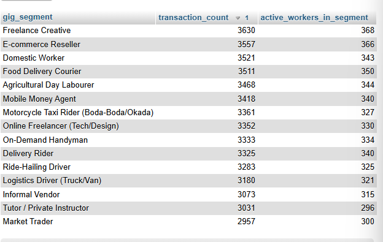

**Commentary**

Across **15 gig segments**, **Freelance Creative (3,630)** has the highest recorded transaction count, while **Market Trader (2,957)** has the lowest. **Note:** the SQL output label `active_workers_in_segment` actually counts **distinct workers who transacted**, not workers whose `is_active` flag is true; interpret it accordingly.

---

## 03 — Payment and risk snapshot

### Q9. What is the distribution of transaction outcomes?

**SQL query**

```sql
SELECT
    transaction_outcome,
    COUNT(*) AS transaction_count,
    ROUND(100.0 * COUNT(*) / (SELECT COUNT(*) FROM raw_fact_transactions), 2)
        AS percentage_of_transactions
FROM raw_fact_transactions
GROUP BY transaction_outcome
ORDER BY transaction_count DESC;
```

**Result screenshot**

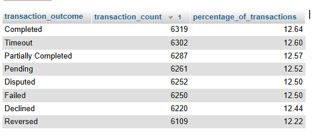

**Commentary**

The eight outcome categories are relatively evenly represented; **Completed (6,319; 12.64%)** is the largest and **Reversed (6,109; 12.22%)** is the smallest. Do not group statuses into a failure rate until their meanings have been validated.

---

### Q10. How many transactions were flagged for potential fraud?

**SQL query**

```sql
SELECT
    COUNT(*) AS total_transactions,
    SUM(CASE WHEN UPPER(TRIM(is_fraud_flagged)) IN ('TRUE','1') THEN 1 ELSE 0 END)
        AS flagged_transactions,
    ROUND(100.0 * SUM(CASE WHEN UPPER(TRIM(is_fraud_flagged)) IN ('TRUE','1')
        THEN 1 ELSE 0 END) / NULLIF(COUNT(*),0), 2) AS fraud_flag_rate_pct
FROM raw_fact_transactions;
```

**Result screenshot**


**Commentary**

**25,145 of 50,000 transactions (50.29%)** were flagged. This is the **fraud-flag rate**, not a confirmed fraud rate; the underlying flagging rule has not been verified.

---

### Q11. How do dispute and reversal flags compare with their outcome labels?

**SQL query**

```sql
SELECT
    SUM(CASE WHEN UPPER(TRIM(is_disputed)) IN ('TRUE','1') THEN 1 ELSE 0 END)
        AS disputed_flag_count,
    SUM(CASE WHEN UPPER(TRIM(is_reversed)) IN ('TRUE','1') THEN 1 ELSE 0 END)
        AS reversed_flag_count,
    SUM(CASE WHEN transaction_outcome = 'Disputed' THEN 1 ELSE 0 END)
        AS disputed_outcome_count,
    SUM(CASE WHEN transaction_outcome = 'Reversed' THEN 1 ELSE 0 END)
        AS reversed_outcome_count
FROM raw_fact_transactions;
```

**Result screenshot**

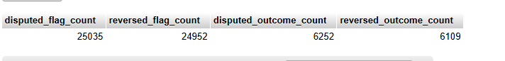

**Commentary**

The query reports **25,035 dispute flags** and **24,952 reversal flags**, compared with **6,252 Disputed outcomes** and **6,109 Reversed outcomes**. Their definitions may differ, so investigate the discrepancy before treating it as an error.

---

### Q12. What are the recorded transaction processing times?

**SQL query**

```sql
SELECT
    ROUND(AVG(CAST(processing_time_ms AS DECIMAL(20,4))),2) AS avg_processing_time_ms,
    MIN(CAST(processing_time_ms AS DECIMAL(20,4))) AS min_processing_time_ms,
    MAX(CAST(processing_time_ms AS DECIMAL(20,4))) AS max_processing_time_ms
FROM raw_fact_transactions;
```

**Result screenshot**


**Commentary**

The reported average processing time is **500.34 ms**, with a **minimum of 0 ms** and **maximum of 1,000 ms**. Check the meaning of zero-duration records during cleaning.

---

## 04 — Monthly trends

### Q13. How do transaction counts and recorded value change by month?

**SQL query**

```sql
SELECT
    DATE_FORMAT(STR_TO_DATE(date_id, '%Y%m%d'), '%Y-%m') AS transaction_month,
    COUNT(*) AS transaction_count,
    ROUND(SUM(CAST(amount_usd AS DECIMAL(20,9))),2) AS transaction_value_usd
FROM raw_fact_transactions
GROUP BY DATE_FORMAT(STR_TO_DATE(date_id, '%Y%m%d'), '%Y-%m')
ORDER BY transaction_month;
```

**Result screenshot**

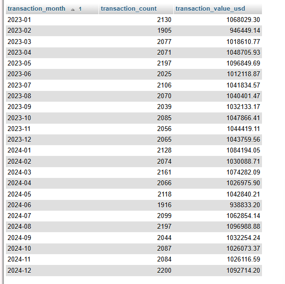

**Commentary**

The screenshot gives monthly transaction counts and USD-denominated value for **24 months**. `amount_usd` is **transaction value, not company revenue**; currency conversion requires validation before financial conclusions.

---

### Q14. How do monthly fraud-flag counts and rates change over time?

**SQL query**

```sql
SELECT
    DATE_FORMAT(STR_TO_DATE(date_id, '%Y%m%d'), '%Y-%m') AS transaction_month,
    COUNT(*) AS transaction_count,
    SUM(CASE WHEN UPPER(TRIM(is_fraud_flagged)) IN ('TRUE','1') THEN 1 ELSE 0 END)
        AS flagged_count,
    ROUND(100.0 * SUM(CASE WHEN UPPER(TRIM(is_fraud_flagged)) IN ('TRUE','1')
        THEN 1 ELSE 0 END) / NULLIF(COUNT(*),0),2) AS flagged_rate_pct
FROM raw_fact_transactions
GROUP BY DATE_FORMAT(STR_TO_DATE(date_id, '%Y%m%d'), '%Y-%m')
ORDER BY transaction_month;
```

**Result screenshot**

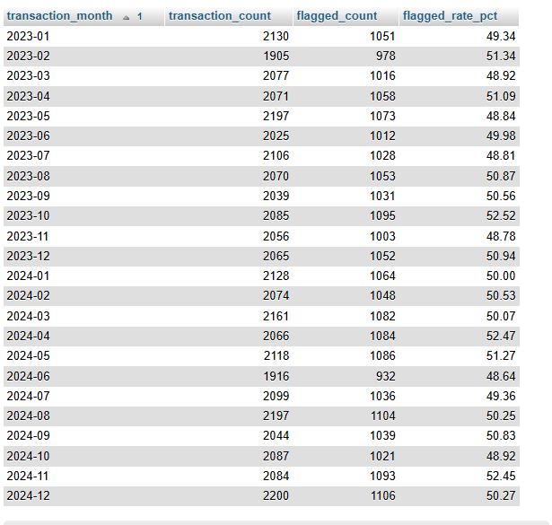

**Commentary**

Monthly flag rates fluctuate around **50%**. The pattern is descriptive and does not demonstrate a causal trend or an increase in independently confirmed fraud.

---

## 05 — Data completeness

### Q15. How many missing cells appear in each source table?

**SQL query**

```sql
SELECT 'raw_fact_transactions' AS table_name,
       COUNT(*) AS total_rows,
       COALESCE(SUM(
        (`transaction_id` IS NULL OR TRIM(`transaction_id`) = '')
        + (`worker_id` IS NULL OR TRIM(`worker_id`) = '')
        + (`date_id` IS NULL OR TRIM(`date_id`) = '')
        + (`channel_id` IS NULL OR TRIM(`channel_id`) = '')
        + (`market_id` IS NULL OR TRIM(`market_id`) = '')
        + (`transaction_type` IS NULL OR TRIM(`transaction_type`) = '')
        + (`amount_local` IS NULL OR TRIM(`amount_local`) = '')
        + (`amount_usd` IS NULL OR TRIM(`amount_usd`) = '')
        + (`transaction_outcome` IS NULL OR TRIM(`transaction_outcome`) = '')
        + (`is_fraud_flagged` IS NULL OR TRIM(`is_fraud_flagged`) = '')
        + (`is_disputed` IS NULL OR TRIM(`is_disputed`) = '')
        + (`is_reversed` IS NULL OR TRIM(`is_reversed`) = '')
        + (`velocity_score` IS NULL OR TRIM(`velocity_score`) = '')
        + (`fraud_loss_usd` IS NULL OR TRIM(`fraud_loss_usd`) = '')
        + (`processing_time_ms` IS NULL OR TRIM(`processing_time_ms`) = '')
       ), 0) AS total_missing_values
FROM `raw_fact_transactions`

UNION ALL

SELECT 'raw_dim_worker' AS table_name,
       COUNT(*) AS total_rows,
       COALESCE(SUM(
        (`worker_id` IS NULL OR TRIM(`worker_id`) = '')
        + (`worker_name` IS NULL OR TRIM(`worker_name`) = '')
        + (`gig_segment` IS NULL OR TRIM(`gig_segment`) = '')
        + (`account_tenure_days` IS NULL OR TRIM(`account_tenure_days`) = '')
        + (`kyc_tier` IS NULL OR TRIM(`kyc_tier`) = '')
        + (`gender` IS NULL OR TRIM(`gender`) = '')
        + (`age_band` IS NULL OR TRIM(`age_band`) = '')
        + (`risk_score` IS NULL OR TRIM(`risk_score`) = '')
        + (`is_active` IS NULL OR TRIM(`is_active`) = '')
        + (`preferred_channel` IS NULL OR TRIM(`preferred_channel`) = '')
       ), 0) AS total_missing_values
FROM `raw_dim_worker`

UNION ALL

SELECT 'raw_dim_channel' AS table_name,
       COUNT(*) AS total_rows,
       COALESCE(SUM(
        (`channel_id` IS NULL OR TRIM(`channel_id`) = '')
        + (`channel_type` IS NULL OR TRIM(`channel_type`) = '')
        + (`channel_subtype` IS NULL OR TRIM(`channel_subtype`) = '')
        + (`is_digital` IS NULL OR TRIM(`is_digital`) = '')
        + (`avg_fraud_rate` IS NULL OR TRIM(`avg_fraud_rate`) = '')
        + (`requires_internet` IS NULL OR TRIM(`requires_internet`) = '')
       ), 0) AS total_missing_values
FROM `raw_dim_channel`

UNION ALL

SELECT 'raw_dim_market' AS table_name,
       COUNT(*) AS total_rows,
       COALESCE(SUM(
        (`market_id` IS NULL OR TRIM(`market_id`) = '')
        + (`country` IS NULL OR TRIM(`country`) = '')
        + (`iso_code` IS NULL OR TRIM(`iso_code`) = '')
        + (`local_currency` IS NULL OR TRIM(`local_currency`) = '')
        + (`dominant_channel` IS NULL OR TRIM(`dominant_channel`) = '')
        + (`regulatory_tier` IS NULL OR TRIM(`regulatory_tier`) = '')
        + (`usd_fx_rate` IS NULL OR TRIM(`usd_fx_rate`) = '')
        + (`market_fraud_index` IS NULL OR TRIM(`market_fraud_index`) = '')
       ), 0) AS total_missing_values
FROM `raw_dim_market`

UNION ALL

SELECT 'raw_dim_date' AS table_name,
       COUNT(*) AS total_rows,
       COALESCE(SUM(
        (`date_id` IS NULL OR TRIM(`date_id`) = '')
        + (`full_date` IS NULL OR TRIM(`full_date`) = '')
        + (`year` IS NULL OR TRIM(`year`) = '')
        + (`month` IS NULL OR TRIM(`month`) = '')
        + (`quarter` IS NULL OR TRIM(`quarter`) = '')
        + (`day_of_week` IS NULL OR TRIM(`day_of_week`) = '')
        + (`is_weekend` IS NULL OR TRIM(`is_weekend`) = '')
        + (`is_month_end` IS NULL OR TRIM(`is_month_end`) = '')
        + (`week_number` IS NULL OR TRIM(`week_number`) = '')
       ), 0) AS total_missing_values
FROM `raw_dim_date`;
```

**Result screenshot**

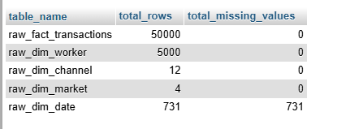

**Commentary**

There are **731 missing cells**, all in `raw_dim_date` (the `week_number` column); the other four tables have zero missing cells under the NULL/blank/whitespace-only definition. Derive week numbers during Python cleaning and verify the results.

---

## Output requiring a rerun — Not a valid finding

**Question:** How do transaction outcomes vary by month?

The screenshot below reports `2024-10 / Disputed / 50,000`. This cannot be correct because **October 2024 has 2,087 transactions total** in the monthly-count output, while **6,252 records are Disputed** across the full dataset. **Do not include this output as a business finding.**

**Corrected SQL to rerun**

```sql
SELECT
    DATE_FORMAT(STR_TO_DATE(date_id, '%Y%m%d'), '%Y-%m') AS transaction_month,
    transaction_outcome,
    COUNT(*) AS transaction_count
FROM raw_fact_transactions
GROUP BY DATE_FORMAT(STR_TO_DATE(date_id, '%Y%m%d'), '%Y-%m'), transaction_outcome
ORDER BY transaction_month, transaction_outcome;
```

**Original screenshot — INVALID; replace after rerun**


**Commentary:** The original query may have counted the full table rather than grouping by month and outcome, but the SQL that produced the screenshot is unavailable, so the root cause is unconfirmed. Rerun the corrected query and replace this image with the new result.

---

## Next steps

1. Correct the flagged monthly-outcome query and replace its screenshot.
2. Clean and validate the five CSVs in Python without modifying the raw staging tables.
3. Check the post-cleaning figures against these raw-data baselines.
4. Use validated data in Power BI for detailed business analysis.

**Interpretation limitations:** Fraud flags are potential risk signals, not confirmed fraud. Transaction value is not PayPesa revenue. Dispute/reversal flags and fraud-loss definitions require business clarification.
